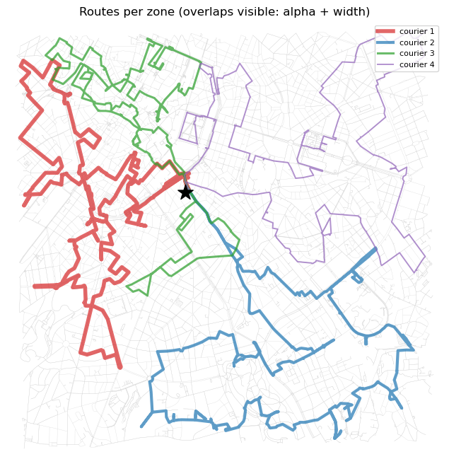

# BiciLogic

**How should a cargo-bike delivery operator in Brussels cut the city into stable courier
zones — and when does a second micro-hub pay for itself?**

A simulation and optimization study on the real Brussels street network: shortest paths,
TSP/VRP routing, workload-balanced districting, and (next) facility location. The discipline
is operations research and geospatial analysis, not machine learning.

> ### Data boundary — read this first
> The **street network is real** (OpenStreetMap via OSMnx: one-ways, cycleways, real link
> lengths). **Demand is simulated** — a spatial point process of hotspots plus uniform
> background. No delivery operator has supplied real orders, and none of the results below
> is a measurement of a live operation. They are statements about a modelled demand process
> on a real network. Anchoring the demand model to open Brussels data (population, POIs) is
> the next data step; it will still be *simulated demand on real anchors*.

Every number on this page is printed by a committed notebook that is stored **with its
outputs**, so it can be checked without re-running anything.

---

## Headline results

### 1. Balancing the obvious quantity makes things worse

An operator's instinct is to give every courier the same number of stops. Doing that
*perfectly* makes the real workload **less** balanced, not more.

Workload here means the actual routed tour from the depot through a zone's stops, in km —
not the stop count, and not the straight-line spread.

| partition (200 stops, k = 4) | stops / zone | stop imbalance | routed km / zone | **routed imbalance** |
|---|---|---|---|---|
| k-means (Euclidean) | 47 / 40 / 84 / 29 | 2.90 | 23.7 / 25.8 / 28.5 / 23.3 | 1.22 |
| count-balanced (network distance) | 50 / 50 / 50 / 50 | **1.00** | 25.5 / 31.3 / 16.8 / 30.4 | **1.86** |
| workload-balanced (BHH) | 56 / 43 / 60 / 41 | 1.46 | 28.7 / 28.3 / 25.8 / 27.5 | **1.11** |

*Imbalance = max / min across zones, at a 2-second routing budget per zone. Source:
[`notebooks/06_districting_workload.ipynb`](notebooks/06_districting_workload.ipynb). The
ordering of the three partitions is stable under a longer routing budget; the size of the gap
is not — see [below](#4-how-much-of-this-is-the-partition-and-how-much-is-the-solver).*

The partition that looks **least** fair by headcount (1.46) is the fairest by actual work
(1.11); the one that is *perfectly* fair by headcount is the **worst** by actual work (1.86).
The reason is structural: equal stop counts say nothing about a zone's **area** or its
**distance from the depot**, and both drive kilometres.

The same reversal appears on an independent instance (180 stops, k = 3, Ixelles —
[`notebook 05`](notebooks/05_districting_balanced.ipynb)): k-means 1.35 → count-balanced
1.62. Two different study areas, different k, same direction.

### 2. The BHH √(nA) law survives on a road network — with a different constant

The fix for (1) needs a workload estimate cheap enough to evaluate inside a search loop, so
zones can be rebalanced without re-routing on every move. The
Beardwood–Halton–Hammersley law gives one: the optimal tour through *n* points spread over
area *A* grows like

```
workload(zone)  ≈  2 · d(depot → zone)  +  β · √(n · A)
                   └── access ──┘          └── internal tour ──┘
```

BHH is stated for **Euclidean** distance over uniform points. Refitting it on the actual bike
network over random point sets of size 10/20/40/60:

**β_net = 1.347, R² = 0.912** — against the standard Euclidean-uniform estimate **0.7124**.

So the functional form `√(nA)` transfers well (R² = 0.912), while the constant is **1.9×**
larger: that factor absorbs the detour imposed by streets, one-ways and barriers. Riding a
network costs roughly twice the idealised Euclidean law — a reusable planning number, not
just an internal parameter.

### 3. Fleet sizing: diminishing returns are sharp and measurable

Minimising the **makespan** (the busiest courier) rather than total distance, over a 24-stop
instance:

| couriers | makespan | total distance |
|---|---|---|
| 1 | 13 912 m | 13 912 m |
| 2 | 8 554 m | 17 056 m |
| 3 | 6 629 m | 19 434 m |
| 4 | **6 073 m** | 21 843 m |
| 5 | 6 073 m | 21 843 m |

The 2nd courier buys 39 % off the makespan, the 4th buys 8 %, and the **5th buys nothing at
all** — the solver leaves it unused. Since each courier is a salary, the decision rule is:
the smallest fleet whose makespan fits a shift budget plus a safety buffer. Source:
[`notebooks/03_multi_courier_vrp.ipynb`](notebooks/03_multi_courier_vrp.ipynb).

### 4. How much of this is the partition, and how much is the solver?

The routed workloads above come from a heuristic solver on a time budget, so they are upper
bounds — possibly of differing tightness per partition. Re-routing the *same three fixed
partitions* at 2 s, 10 s and 30 s per zone separates the two effects
([`tools/solver_budget_sensitivity.py`](tools/solver_budget_sensitivity.py)):

| routing budget | k-means | count-balanced | workload-balanced (BHH) |
|---|---|---|---|
| 2 s | 1.224 | 1.857 | **1.110** |
| 10 s | 1.208 | 1.857 | 1.156 |
| 30 s | 1.194 | 1.857 | 1.162 |

*Routed imbalance. Run-to-run variation is negligible: 11 of the 12 (budget, partition) pairs
were bit-identical across repeats, and the one exception differed by 42 m on a single zone,
leaving busiest, total and imbalance unchanged. The variation in the table is the budget, not
solver randomness.*

- **The negative result is robust.** Count-balancing sits at 1.857 at every budget and its
  busiest courier is stuck at 31.3 km. More solver time cannot rescue a bad partition.
- **The size of BHH's margin is not.** The 1.11-vs-1.22 gap shrinks by about a factor of three
  as the solver improves. The ordering holds; the magnitude quoted from a single 2-second run
  overstates it.

This is reported rather than quietly dropped, because it is also the argument for the next
milestone: if two partitions are within a single day's noise, the question that separates them
is what happens across *many* days.

---



*One courier per colour, routed from the shared depot (★) through its own zone. This is the
BHH-balanced partition from the table above — and it also shows the method's current
weakness: **zone contiguity is not enforced**, so the green zone is split into a northern and
a southern lobe. A courier's territory must be one connected area; fixing this is the next
piece of work, not a detail to hide.*

---

## What is honest to claim, and what is not

- **Demand is synthetic.** See the data boundary above. The *reversal* in result (1) is a
  structural fact about area and depot distance, not an artefact of the hotspot model — but
  the specific ratios (1.22 / 1.86 / 1.11) belong to this simulated instance.
- **One demand day, not a distribution.** The table compares partitions on a *single*
  realisation. The whole point of fixed zones is that demand is random *every day*, so the
  honest metrics are expected makespan, per-zone variance and probability of overflowing a
  shift. That is the next milestone (L4.4) and it is not done yet.
- **Against count-balancing the win is unambiguous** — the busiest courier drops from
  31.3 km to 28.4 km — but **against k-means it is not a win on the busiest courier.** At
  every routing budget tested, k-means' busiest zone is slightly *shorter* than BHH's
  (27.8 km vs 28.4 km at 30 s). What BHH improves is evenness: it raises the lightest zone
  (23.3 → 24.5 km) more than it raises the heaviest (27.8 → 28.4 km). In other words it
  balances by **lifting the floor, not lowering the ceiling**.
- **Balance costs total distance.** 108.3 km for BHH against 100.5 km for k-means (+ 7.8 %).
  The same min-sum vs makespan trade-off as in result (3), one level up: fairness across
  riders is bought with kilometres.
- **Routed workloads come from a heuristic TSP** (OR-Tools on a time budget), so they are
  upper bounds on the optimum, not exact tour lengths — which is why result (4) exists.
- **Contiguity is not enforced** (see the figure caption).
- **Elevation and load-dependent cost are not modelled yet** (planned as L6).

---

## Reproducing

```bash
pip install -r requirements.txt
jupyter lab notebooks/                      # run 01 → 06 in order
python tools/export_notebook_figures.py     # figures in outputs/, from the stored cell outputs
python tools/solver_budget_sensitivity.py   # result (4) → outputs/solver_budget_sensitivity.json
```

OSMnx caches its downloads under `notebooks/cache/` (gitignored), so only the first run
touches the network. The notebooks are committed **with their outputs**: every figure in
`outputs/` is exported from those stored outputs by
[`tools/export_notebook_figures.py`](tools/export_notebook_figures.py), so no figure exists
in the repo without the cell that produced it.

## Repository map

```
notebooks/01_real_map_brussels.ipynb     real bike network + one shortest path
notebooks/02_single_courier_tsp.ipynb    point-to-network snapping, distance matrix, TSP
notebooks/03_multi_courier_vrp.ipynb     VRP, makespan objective, fleet sizing
notebooks/04_districting.ipynb           k-means zoning baseline, and why it fails
notebooks/05_districting_balanced.ipynb  count-balanced zones — the negative result
notebooks/06_districting_workload.ipynb  BHH workload-balanced zones

src/geo_utils.py   snapping via a virtual access node on the nearest edge; distance matrices
src/tsp.py         naive / nearest-neighbour / brute force / 2-opt / simulated annealing
src/vrp.py         OR-Tools VRP with a "sum" or "makespan" objective

tools/export_notebook_figures.py    figures in outputs/, exported from the stored cell outputs
tools/solver_budget_sensitivity.py  result (4): routing budget vs partition quality
outputs/           figures and machine-readable metrics
```

## Method notes

**Point-to-network snapping.** A delivery address almost never sits on a graph node.
Snapping to the nearest *node* is a poor approximation in the middle of a long edge and
forces an arbitrary choice of which end to enter from. Instead each point is projected onto
the nearest **edge** and a direction-aware **virtual node** splits that edge, letting the
router pick the entry endpoint itself. On the test instance this changes distance-matrix
entries by up to **132.6 m** (mean 21.6 m). The diagnostic also exposes bad inputs rather
than hiding them: one test point sits **319 m** from any bike link, i.e. effectively off the
network.

**Asymmetric distances.** The graph is directed (one-ways), so `D[i][j] ≠ D[j][i]`. Each row
is one `single_source_dijkstra_path_length` call.

**Solver validation.** On a 5-stop instance, brute force gives the exact optimum **6189 m**
(input order: 9401 m); both 2-opt and simulated annealing reach it. On a 15-stop instance
2-opt stalls *exactly* at the nearest-neighbour tour (14 060 m → 14 060 m — a local minimum,
and 2-opt is weak on asymmetric matrices because reversing a segment flips travel direction),
while simulated annealing reaches **12 498 m (−11 %)**.

**Districting method.** Continuous approximation to design, discrete local search to refine,
real routing to validate: estimate zone workload with the calibrated BHH formula → greedily
move the most borderline stop from the heaviest zone to the lightest → re-route every zone
for real at the end to check the estimate did its job.

## Roadmap

| | | status |
|---|---|---|
| L1 | Shortest path on the real network (Dijkstra) | done |
| L2 | One courier, N stops (TSP); exact vs heuristics | done |
| L3 | k couriers (VRP); makespan vs min-sum; fleet sizing | done |
| L4.1–4.3 | Districting: k-means baseline → count-balance → BHH workload balance | done |
| **L4.4** | **Robust zones: fixed zones vs M simulated demand days; E[max], CV, P(overflow); contiguity enforced** | **next** |
| L5 | Second micro-hub: p-median, improvement heatmap, break-even cost | planned |
| L6 | Slope + load-dependent edge cost (breaks the fixed-matrix TSP) | planned |
| L7 | Sensitivity of the conclusions to the arbitrary parameters | planned |
| Product | Interactive dashboard (Streamlit / folium): couriers, hubs, scenario → routes + metrics | planned |

### Next steps

**L4.4 — robust zones.** Zones are fixed, but demand is random every day, so the right target
is balance *in expectation with low variance*, not balance on one instance:

1. Simulate M demand days from the same spatial process, keeping the zones fixed.
2. Route every zone on every day → a workload distribution per zone.
3. Compare the three partitions on E[max workload] (expected makespan), per-zone CV, and
   P(overflow) — the probability that a courier exceeds the shift budget.
4. Optimise directly for the robust objective (e.g. E[max] + λ·std), reusing the BHH estimate
   so the inner loop stays cheap.
5. Enforce **zone contiguity** in the same step (only accept swaps that keep each zone
   connected, or add a compactness penalty).

### Known gaps

- **No automated tests yet.** A first test should check Bellman subpath optimality of the
  shortest paths, plus the solvers against brute force on small instances.
- **Metrics live inside notebooks.** Key results should also be written to machine-readable
  files (`outputs/*.json`), as `solver_budget_sensitivity.json` already is.
- **Demand is not yet anchored to real data** (population / POI density).

## Environment

Python 3.12; see [`requirements.txt`](requirements.txt). Key versions used to produce the
stored outputs: OSMnx 2.1.0, OR-Tools 9.15, scikit-learn 1.9, NetworkX 3.6.

## License

MIT — see [LICENSE](LICENSE).
